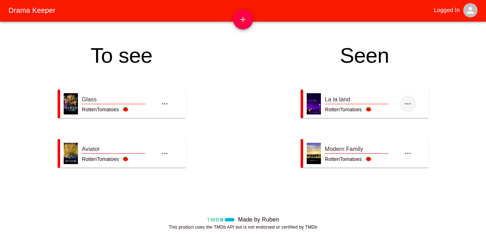
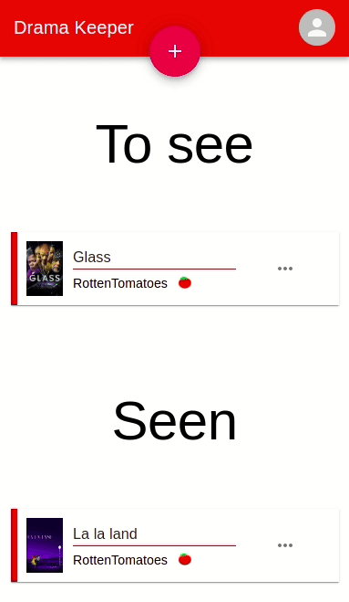
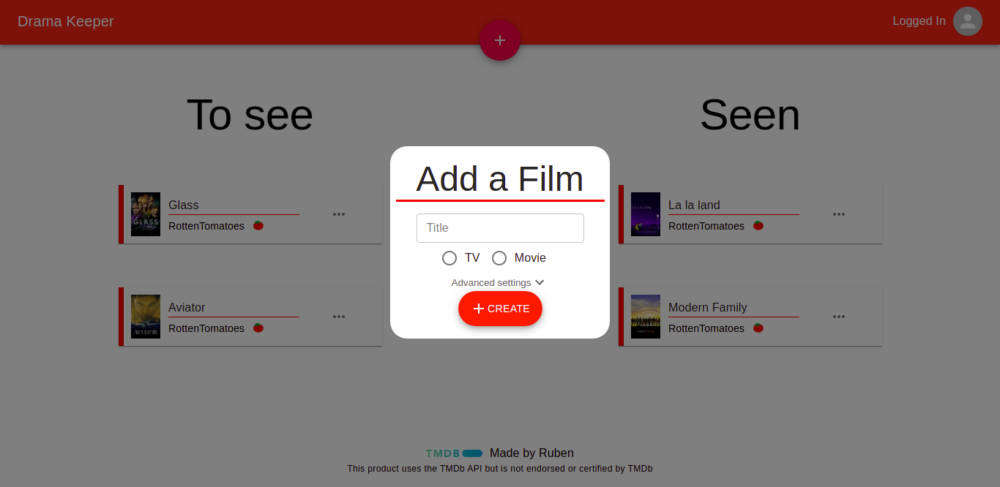
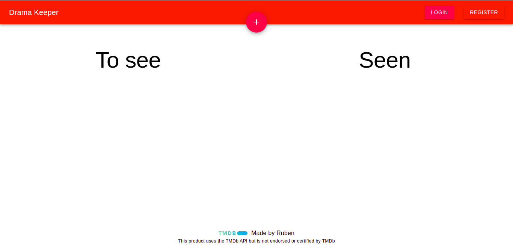

# Drama Keeper

**Live demo**

[drama-keeper-client.vercel.app](http://drama-keeper-client.vercel.app/)

Keep a record of the films you want to see or the ones you have watched.



## Goals

- [x] Integrate a backend with a frontend
- [x] Learn TypeScript
- [x] Deploy a Fullstack app
- [x] Learn React
- [x] Use my custom hooks in react
- [x] Use react context
- [x] Integrate a third-party API

## About the project

In Drama Keeper you can create an account and have a database to save the films you want to see and the ones you already watched.

The server uses the [TMDb API](https://www.themoviedb.org/) to get film poster image.

> Any image is saved in the DB. Only the poster path.

## Screenshots





## Tech used

* [Node.js](https://nodejs.org/) 26 and [pnpm](https://pnpm.io/) 12
* [Express](https://expressjs.com/) 5 - For the server
* [MongoDB](https://www.mongodb.com/) with [Mongoose](https://mongoosejs.com/) - For the database
* [TypeScript](https://www.typescriptlang.org/) - For the strong typing
* [React](https://react.dev/) 19 with [Vite](https://vite.dev/) - For the frontend
* [MUI](https://mui.com/) - To make it cute
* [Google Identity Services](https://developers.google.com/identity/gsi/web) - For "Sign in with Google"
* [Vitest](https://vitest.dev/) and [Playwright](https://playwright.dev/) - For the tests
* Hosting: the API on [Railway](https://railway.com/), the client on [Vercel](https://vercel.com/)

## Build the app

### What you need before

- Node.js 26 (see `.nvmrc`)
- pnpm 12 (`npm i -g pnpm@12.16.1`)
- A [MongoDB](https://www.mongodb.com/) database
- A [TMDb API Key](https://developers.themoviedb.org/3/getting-started/introduction)

### Steps

1. Clone this repository
2. With terminal project root folder, to install dependencies run:
```
$ pnpm install && pnpm --dir client install
```
3. Rename the file `.env.example` to `.env` and fill it. Do the same for `client/.env.example` -> `client/.env`.
4. **Run the app:**
```
$ pnpm app
```

The API listens on http://localhost:4000 and the client on http://localhost:3000. The client reads its settings from `client/.env` (copy `client/.env.example`).

The app should run ok.

Other API scripts: `pnpm dev` (API only, reloads on change), `pnpm test` (Vitest; needs `MONGO_URI_TEST` in `.env`), `pnpm typecheck`, `pnpm lint`, and `pnpm build && pnpm start` (compiled API from `dist/`, as in production).

Client scripts (run with `pnpm --dir client <script>`): `dev`, `build`, `preview`, `test`, `typecheck`, `lint`, and `e2e` (Playwright; needs MongoDB and the API env vars, CI runs it).

## Environment variables

The API reads `.env` at the project root (see `.env.example`):

| Variable | Required | Description |
| --- | --- | --- |
| `PORT` | No | Port the API listens on. Defaults to `4000`. |
| `MONGO_URI` | Yes | MongoDB connection string. |
| `MONGO_URI_TEST` | For tests | Separate MongoDB database used by `pnpm test`. Tests wipe it. |
| `tokenKey` | Yes | Secret used to sign login JWTs. |
| `TMDb_API_KEY` | Yes | TMDb API key, used to find film posters. |
| `SERVER_AUTH_TOKEN` | In production | Token the client must send in the `server-authorization` header. Only checked when `NODE_ENV=production`. |
| `GOOGLE_CLIENT_ID` | For Google sign-in | Google OAuth Web client ID. |
| `RATE_LIMIT_PER_MINUTE` | No | Requests per minute per IP. Defaults to `20`. |
| `NODE_ENV` | In production | Set to `production` to enable the `SERVER_AUTH_TOKEN` check. |

The client reads `client/.env` (see `client/.env.example`). Vite bakes these into the bundle at build time, so they are public:

| Variable | Description |
| --- | --- |
| `VITE_API_URL` | Base URL of the API, e.g. `http://localhost:4000`. |
| `VITE_SERVER_AUTH_TOKEN` | Same value as the API's `SERVER_AUTH_TOKEN`. |
| `VITE_GOOGLE_CLIENT_ID` | Same value as the API's `GOOGLE_CLIENT_ID`. |

For Google sign-in, the client's origin (for local development, `http://localhost` and `http://localhost:3000`) must be an authorized JavaScript origin of the OAuth client in Google Cloud Console.

## Contact me!

- Email: ruben.pardes25@gmail.com
- Discord: Ruberoni#8428

## Attribution

For the film posters, [TMDb](https://www.themoviedb.org/) is used.
